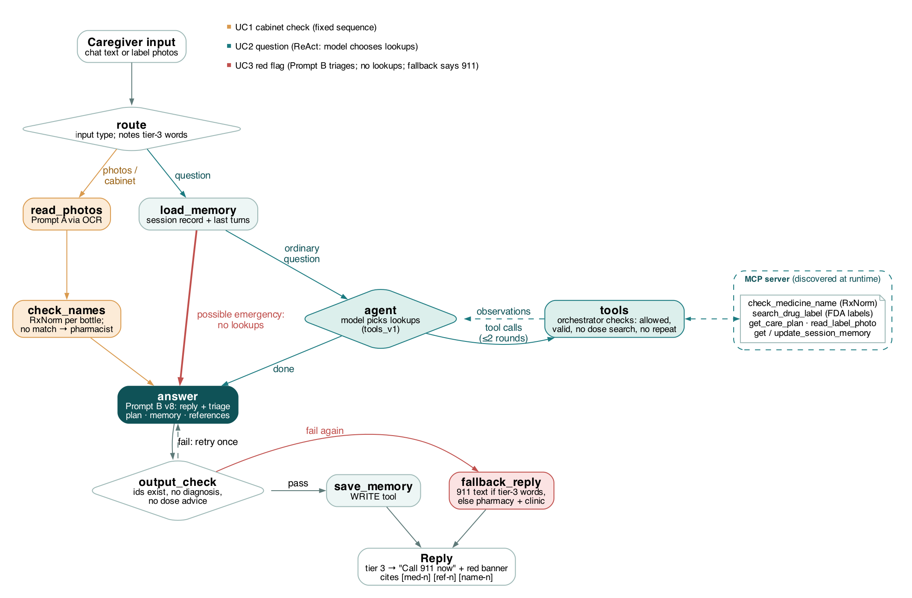

# HomeStretch: Workflow, Tool Use, and Orchestration

Group 5 · A4 built by Anmol Shetty · November 2026
Code, tests, every run, and the full write-up: [**github.com/anmolshetty02/homestretch**](ghtree:docs/workflow/), `docs/workflow/README.md`. Underlined results link to the exact file.

## 1. The workflow

Maria cares for her mother Rosa after a heart-failure discharge. Every message she sends goes through one LangGraph
pipeline (Figure 1). The model decides what to look up and how urgent the message is; fixed rules check everything it
does. Prompt A (A2) reads label photos; Prompt B v8 (A3, unchanged) writes every reply.

Figure 1. One message through HomeStretch. Node names match <code>app/graph.py</code>. Colors mark the three use cases.

| Use case | Path | Pattern |
|---|---|---|
| UC1 Cabinet check | photos → Prompt A (OCR) → RxNorm name check per bottle → Prompt B compares bottles with the plan | Plan-then-execute: the steps never change |
| UC2 Question | memory → the model chooses lookups ⇄ the orchestrator runs them (at most 2 rounds) → Prompt B answers | ReAct: the steps depend on the question |
| UC3 Red flag | Prompt B sets the tier; tier 3 opens "Call 911 now" (red banner); emergency words skip lookups | Model triage, with a fixed fallback |

Every path ends the same way: an output check (ids exist, no diagnosis, no dose advice) → one retry with the failures
→ a safe fallback reply (the fixed 911 text if emergency words were seen) → save memory.

## 2. Tool use, ReAct, and MCP

**Action vs response.** A tool-choice prompt ([tools v1](gh:prompts/tools_v1.md)) lets the model propose lookups,
and the orchestrator decides whether they run (Module 8's hybrid invocation). It allows only listed tools with valid
JSON, refuses repeats, and never runs a label search on a dose question. The model asked for one on a dose or stop
question 4 times, and all 4 were blocked. Errors go back to the model as observations, never as crashes.

| Tool (served over MCP) | What it does | Guard |
|---|---|---|
| `check_medicine_name` | RxNorm lookup for any name not in the plan | no match → "ask the pharmacist", never a guess |
| `search_drug_label` | FDA label passages (A3 retrieval: hybrid search, reranked, top 5) | unknown names get no passages |
| `get_care_plan`, `read_label_photo` | plan items; Prompt A on a label photo | id and path checks |
| `get_session_memory`, `update_session_memory` | the A3 session record; the write tool | write is orchestrator-only |

**MCP.** The six tools run on a real MCP server ([`app/mcp_server.py`](gh:app/mcp_server.py), MCP Python SDK 2.3,
HTTP). The agent discovers them at runtime and calls them by name, so a tool can change without touching the agent.
[`app/test_mcp.py`](gh:app/test_mcp.py) runs a cabinet check and a follow-up over the server.

**Context flow.** Each source fills its own slot in Prompt B: the care plan → `{{care_plan}}`; the session record and
last turns → `{{memory}}`; label passages and name checks from tools → `{{references}}` (cited as `[ref-n]`,
`[name-n]`); this session's cabinet flags → `{{cabinet_diff}}`. The pipeline asserts the references reached the prompt.

## 3. Choosing the platform

| | LangGraph (chosen) | n8n | Plain Python loop |
|---|---|---|---|
| Branching and loops | graph edges; the graph is the diagram | visual nodes | hand-written |
| Reuse our Python checks and retrieval | direct | wrap each one | direct |
| MCP | official SDK | MCP Client Tool / Server Trigger nodes [6] | official SDK |
| Batch-test hundreds of inputs | one function, `run_turn()` | its own runner | yes |
| License | MIT | Sustainable Use License: free to self-host, not OSI open source [7] | n/a |

We chose LangGraph because our safety checks and retrieval already exist as Python and must be scored by the same
tests as A2 and A3. n8n would be easier for non-programmers to edit, but every check would need rewriting.

## 4. Results

Final code, `deepseek-flash`, one run per set; two of the four sets were written by fresh agents that never saw the
code. "v8 alone" is the A3 single prompt, which is also the no-tools ablation: without tools the pipeline sends it the
identical prompt.

| Set (inputs) | v8 alone | Pipeline |
|---|---|---|
| Main cases (57) | 56 | [56](gh:results/pipeline-gateoff_deepseek-flash_1115-1321/summary.md) |
| Confirm (54) | 51 | [52](gh:results/pipeline-gateoff_deepseek-flash_1115-1323_confirm/summary.md) |
| A4 held-out, fresh agent (59) | 59 | [59](gh:results/pipeline-gateoff_deepseek-flash_1115-1325_a4_heldout/summary.md) |
| A4 triage, second fresh agent (52) | 51 | [51](gh:results/pipeline-gateoff_deepseek-flash_1115-1327_a4_triage/summary.md) |

**Same safety, grounded answers.** The pipeline answered all 69 emergencies "Call 911 now" and made the right tool
choice 31 of 31 times. Pass rates match the single prompt; the +1 is within one run's noise, so we do not claim it.
The gain is in what it can answer: on 7 drug-label questions, 4 replies cite an FDA label ("The label says cough is a
common lisinopril reaction [ref-1]") where the single prompt deferred all 7; all 9 unfamiliar names get an RxNorm
answer.
Cost: $0.0007 per turn (about 2× the single prompt), 2.7 s median.

**Other patients.** On the A2 held-out set of 20 other synthetic patients (aged 51 to 86, 3 to 11 medicines, 50 inputs), both
the single prompt and the pipeline pass [50 of 50](gh:results/pipeline-gateoff_deepseek-flash_1115-1319_heldout/summary.md),
and the pipeline cites the FDA label on 4 of 6 "can he take Advil?" questions where the single prompt cites none.

**The 911 rule: decided by data.** We started with a fixed word rule that sent "Call 911 now" before any model call.
The first held-out set showed it fired on "**no** chest pain" and "nearly **fainted** finding parking". We built three
variants, wrote the decision rule before testing ([README §3b](gh:docs/workflow/README.md)), and ran each once on a
fresh triage set (26 real emergencies, many with no keyword, and 26 traps):

| Variant | Emergencies caught | False "Call 911 now" |
|---|---|---|
| Word rule answers first | 26 / 26 | 9 |
| Word rule adds a 911 line only if missing | 26 / 26 | 1 |
| **Prompt B triages alone (chosen)** | 26 / 26 | 1 |

The rule caught nothing the model missed, so triage moved to the model. The word rule now does only what a false
match cannot hurt: skipping lookups and choosing the fallback text.

## 5. Challenges and how we fixed them

Each was found by a test or an independent review, fixed, and re-tested on the final runs above.

- *Context management:* tools called in-process silently used the mock model (the orchestrator now passes the model
  through); the checker rejected this session's own flag ids (now valid); past turns in a short format were copied by
  the model (they now go in the memory slot); Rosa was built into the code (the patient is now a parameter set by the
  orchestrator, Rosa's inputs stayed byte-identical, and 20 more patients were tested).
- *Tool integration:* MCP SDK v2 renamed its APIs (typed wrappers and readable errors; an independent client, the MCP
  Inspector, now lists and calls all six tools); RxNorm keeps "Toprol XL" under a retired id (retry on the base name).
- *Orchestration logic:* the 911 word rule (decided by the experiment above); 32 of 69 emergencies ran a lookup
  before the 911 reply (emergency words now skip lookups); the dose block caught "extra pillows" (rule narrowed).
- *Reliability:* the label index took 106 s to build (vectors cached, about 1 s); the output check's retry and
  fallback paths are unit-tested, and no reply needed them in 222 test turns.

**Next steps.** Labels for every medicine across the 21 patients; label search only when the plan does not answer;
an installable phone app with reminders.

## References

[1] Yao et al., ReAct: Synergizing Reasoning and Acting in Language Models, https://arxiv.org/abs/2210.03629
[2] Model Context Protocol, https://modelcontextprotocol.io; MCP Python SDK, https://github.com/modelcontextprotocol/python-sdk
[3] LangGraph, https://docs.langchain.com/oss/python/langgraph/overview
[4] NIH RxNav (RxNorm), https://lhncbc.nlm.nih.gov/RxNav/; openFDA drug labels, https://open.fda.gov
[5] DeepSeek API, https://api-docs.deepseek.com; Streamlit, https://streamlit.io; Tesseract OCR, https://github.com/tesseract-ocr/tesseract; fastembed, https://github.com/qdrant/fastembed (BAAI bge-base-en-v1.5, ms-marco MiniLM cross-encoder)
[6] n8n MCP Client Tool, https://docs.n8n.io/integrations/builtin/cluster-nodes/sub-nodes/n8n-nodes-langchain.toolmcp/; MCP Server Trigger, https://docs.n8n.io/integrations/builtin/core-nodes/n8n-nodes-langchain.mcptrigger/
[7] n8n Sustainable Use License, https://github.com/n8n-io/n8n/blob/master/LICENSE.md
[8] INFO 7375 Module 8 (Tool Calling, MCP, ReAct, Agent Layer); ComplaintIQ Tool Use and Orchestration lab
[9] AI tools: Claude Code (Claude Opus 5.5) wrote most of the code and drafts, with Anmol reviewing each step; DeepSeek deepseek-flash is the app's model.
